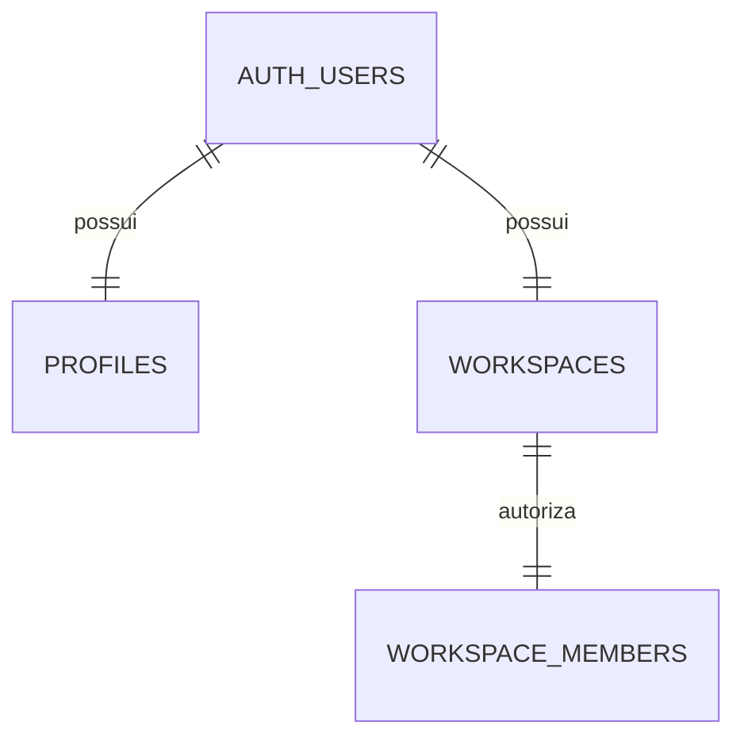
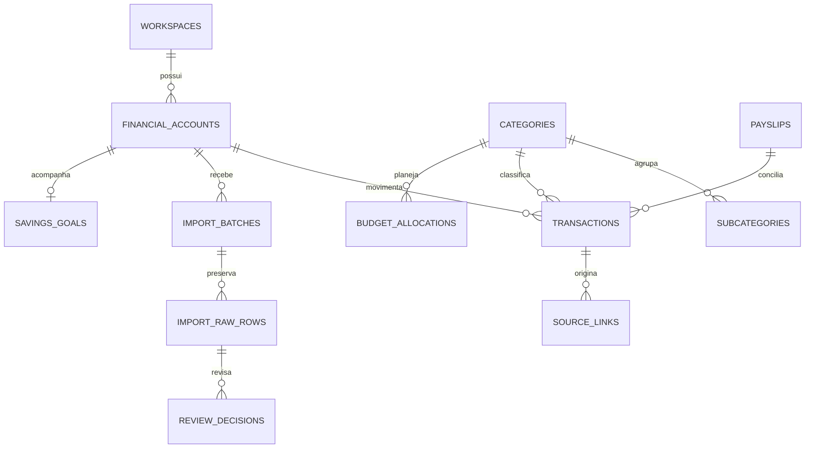

# Schema e segurança

202611090001_identity.sql: trigger de provisionamento, RLS e grants explícitos, Storage privado. Funções privilegiadas têm search_path vazio, EXECUTE público revogado e checagem da identidade Auth.

Nenhuma função permite escolher outro proprietário. Membership usa FK composta (workspace_id,user_id) → (id,owner_id). Perfis só permitem alteração do nome e solicitação de exclusão. Não há views como dono nem publicação realtime habilitada.

Migration 002 implementa contas, taxonomia, regras, cartões, metas, caixinhas, holerites, livro, lotes, linhas, decisões, proveniência e auditoria. Índices de livro por workspace/competência/status e workspace/conta/data bancária. Cadastros têm SELECT/INSERT/UPDATE próprios; DELETE negado. Livro e ingestão têm SELECT próprio e escrita somente por RPC autorizada. Todas as FKs de domínio carregam workspace_id.

Migration 003 adiciona conexões/consentimentos/sync com RLS somente leitura e intenções em schema privado. RPCs derivam workspace do Auth e bloqueiam por estado, escopo e expiração. SELECT FOR UPDATE serializa sincronização e revogação.
