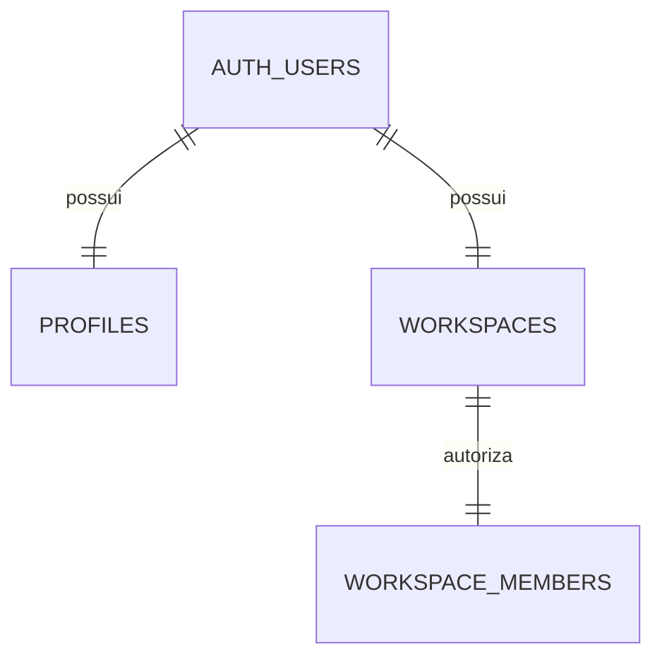

# Schema e segurança

202611090001_identity.sql: trigger de provisionamento, RLS e grants explícitos, Storage privado. Funções privilegiadas têm search_path vazio, EXECUTE público revogado e checagem da identidade Auth.

Nenhuma função permite escolher outro proprietário. Membership usa FK composta (workspace_id,user_id) → (id,owner_id). Perfis só permitem alteração do nome e solicitação de exclusão. Não há views como dono nem publicação realtime habilitada.
