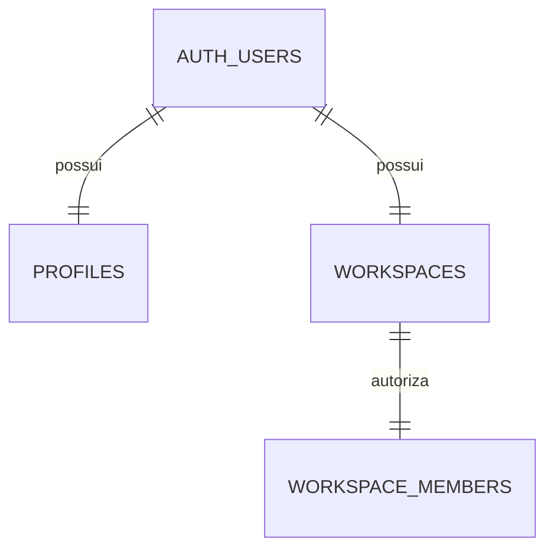
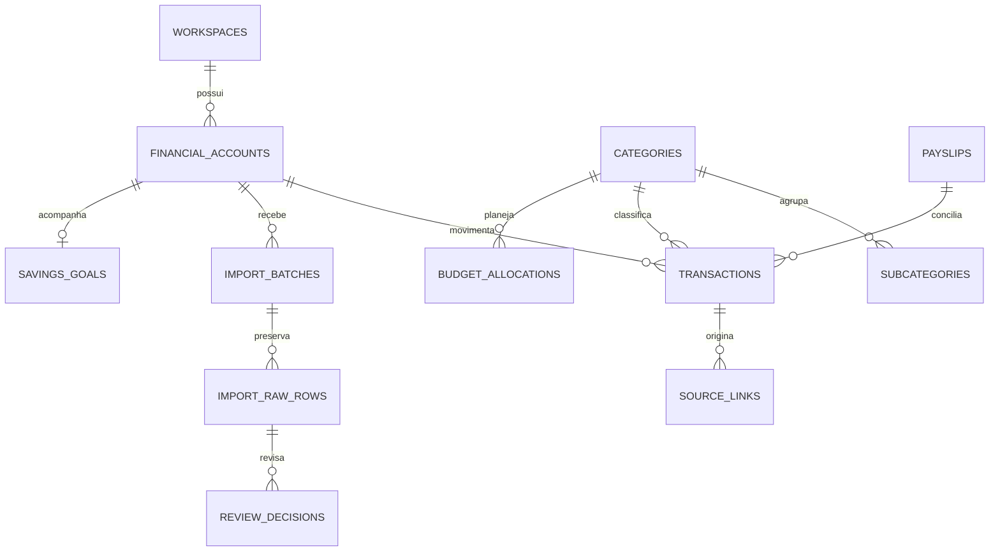
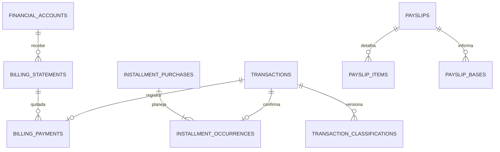

# Schema e segurança

202611090001_identity.sql: trigger de provisionamento, RLS e grants explícitos, Storage privado. Funções privilegiadas têm search_path vazio, EXECUTE público revogado e checagem da identidade Auth.

Nenhuma função permite escolher outro proprietário. Membership usa FK composta (workspace_id,user_id) → (id,owner_id). Perfis só permitem alteração do nome e solicitação de exclusão. Não há views como dono nem publicação realtime habilitada.

Migration 002 implementa contas, taxonomia, regras, cartões, metas, caixinhas, holerites, livro, lotes, linhas, decisões, proveniência e auditoria. Índices de livro por workspace/competência/status e workspace/conta/data bancária. Cadastros têm SELECT/INSERT/UPDATE próprios; DELETE negado. Livro e ingestão têm SELECT próprio e escrita somente por RPC autorizada. Todas as FKs de domínio carregam workspace_id.

Migration 003 adiciona conexões/consentimentos/sync com RLS somente leitura e intenções em schema privado. RPCs derivam workspace do Auth e bloqueiam por estado, escopo e expiração. SELECT FOR UPDATE serializa sincronização e revogação.

Migrations 004–006: grants de cadastro por coluna, tipos de conta imutáveis, restauração atômica, faturas/pagamentos, planejamento/ocorrências de parcelas, rubricas/bases e histórico de classificação. Índice parcial `one_counterpart_per_event` e trigger diferido validam pares patrimoniais com contas distintas, natureza e status iguais, valores opostos. UUIDs, workspace e timestamps de cadastros não podem ser escolhidos/alterados por escrita direta.

Migration 007: PK composta `(workspace_id,id)` em todas as entidades financeiras; workspaces/profiles mantêm identidade global criada pelo backend. FKs financeiras já eram compostas. Intenções privadas passam a PK `(workspace_id,connection_id)` e o trigger deriva workspace do usuário. Evita sondagem por colisão de UUID em restauração e mantém isolamento inclusive com IDs iguais entre usuários. Bucket financial-files tem public=false reforçado.

Migrations 008–009: validação de propostas no servidor (aplica-se também a restore), coerência entre status e vínculo contábil, exportação dos metadados próprios de perfil/workspace e proteção contra perfil cruzado na restauração. RPCs antigas usadas como implementação interna têm EXECUTE revogado de authenticated/public.

